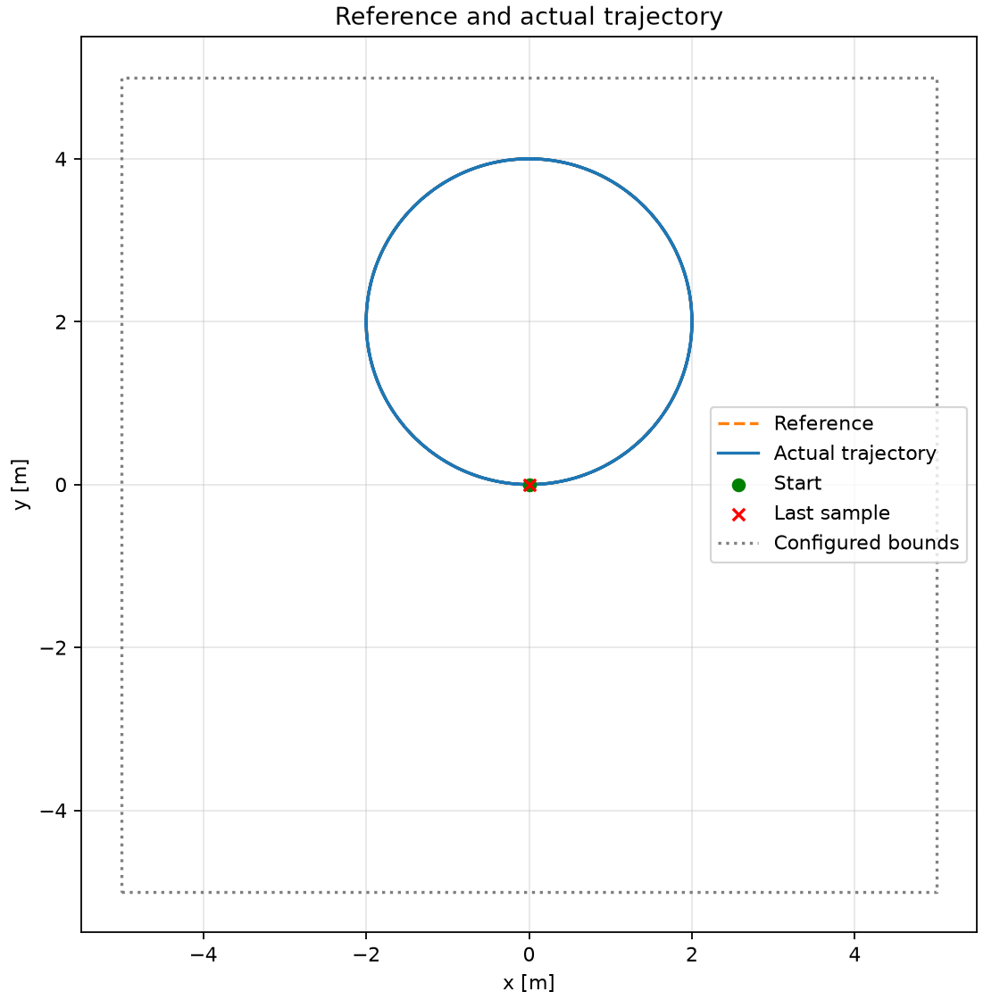
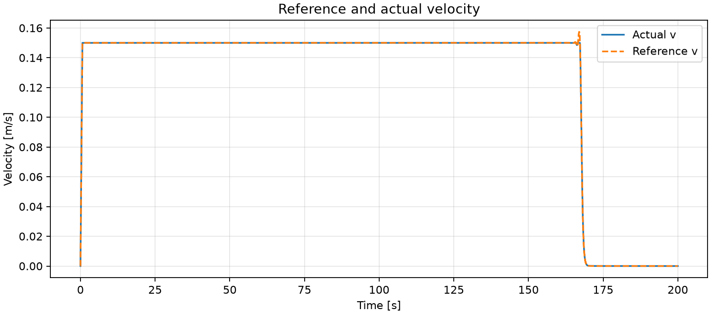
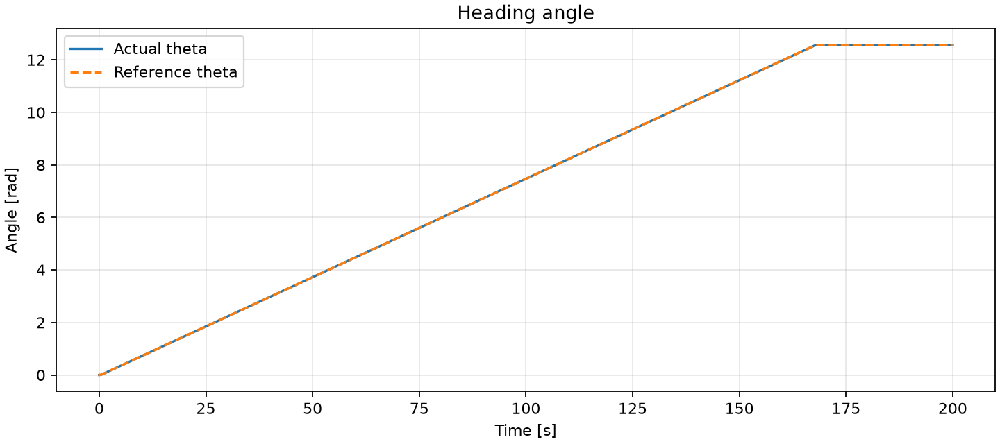
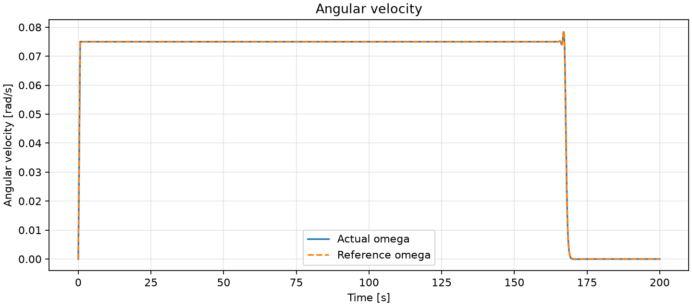
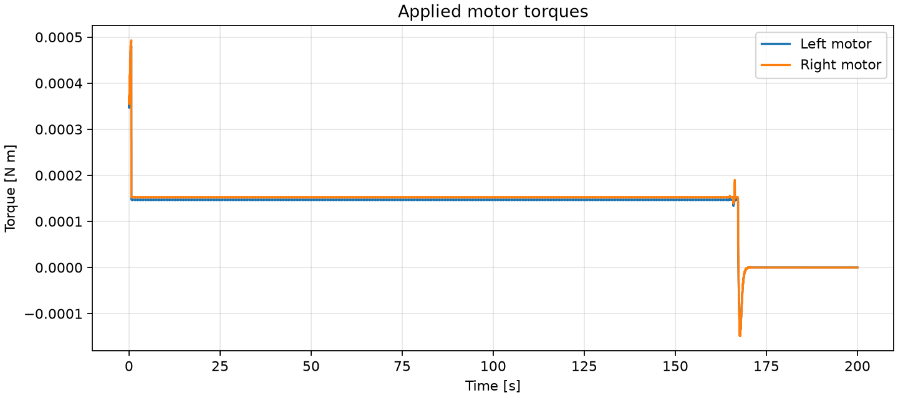
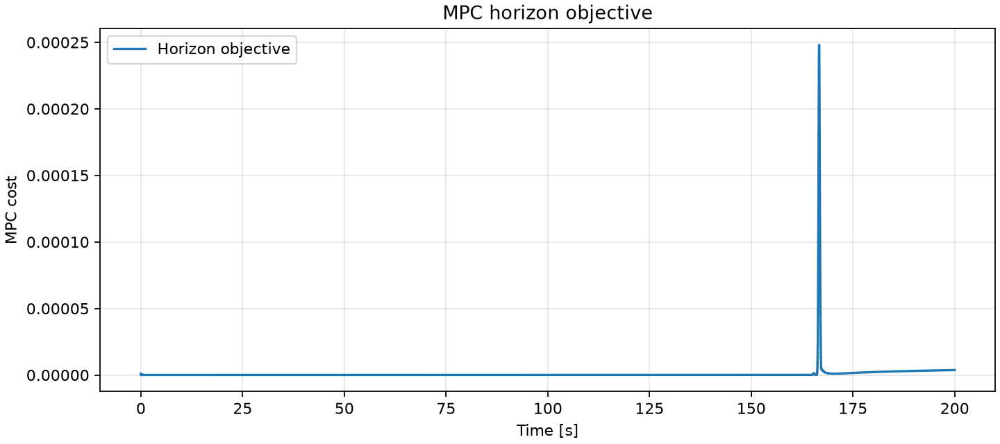
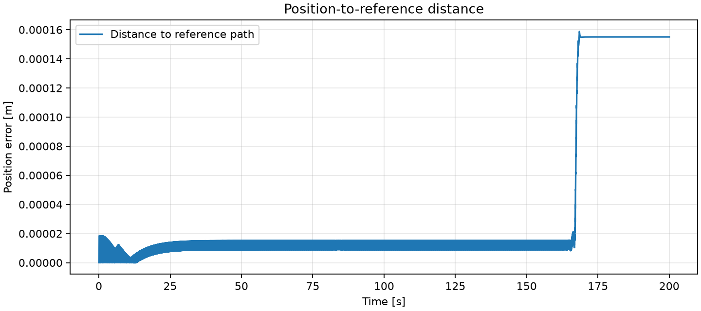

# Experiment 2026-10-13_21-36-10-748239_radius-2.0_heading-0.0_turns-2_counterclockwise

Started: 2026-10-13T21:36:10.748239+02:00

Plant: `sim`

Status: `completed`

Samples: 200000; last recorded simulation time: 199.999 s

## Results















## Tracking evaluation

| Deviation | Samples | MSE | MAE | RMSE | Max |
| --- | ---: | ---: | ---: | ---: | ---: |
| Position-to-reference distance | 200000 | 3.99506e-09 m² | 3.39043e-05 m | 6.32065e-05 m | 0.000158799 m |
| Linear velocity v − v_ref | 200000 | 9.76265e-08 (m/s)² | 4.39307e-05 m/s | 0.000312452 m/s | 0.00736382 m/s |
| Orientation wrap(θ − θ_ref) | 200000 | 1.46036e-07 rad² | 0.000297307 rad | 0.000382147 rad | 0.00191673 rad |
| Angular velocity ω − ω_ref | 200000 | 4.8479e-09 (rad/s)² | 1.74606e-05 rad/s | 6.96269e-05 rad/s | 0.00109666 rad/s |

MSE = mean(e²), MAE = mean(abs(e)), RMSE = sqrt(MSE), Max = max(abs(e)). All evaluated samples have equal weight, including partial runs. Position error is the shortest distance to the line segments in reference.csv; this approximates the continuous reference and does not measure timing, lap progress or path completion. Velocity error is v − v_ref at the same recorded time. v_ref is the first velocity of the latest MPC reference window, held between MPC updates. Orientation error is the shortest angular difference atan2(sin(θ − θ_ref), cos(θ − θ_ref)); angular velocity error is ω − ω_ref without angle wrapping. Angular references likewise use the first stage of the latest MPC window, held between updates. During startup rotation this first stage is initialized from the measured orientation and angular velocity. Samples missing a reference are excluded from the corresponding evaluation. Evaluation unavailable (—) indicates missing data.

## Data convention

`data.csv` contains the plant state at time_s before integration, and the control applied over the following plant interval. Angles are in rad, positions in m, velocities in m/s and rad/s, torques in N m. `cost` is the latest MPC horizon objective (not an instantaneous stage cost); it is held between updates. `mpc_updated=1` marks a new MPC solution. `theta_ref` and `omega_ref` are the first-stage heading and angular velocity of the latest MPC reference window, held between updates, including startup rotation. theta_ref uses the angle branch aligned to the plant state by the controller. The last row can precede an interrupted or failed integration step.

## Experiment configuration

```yaml
robot:
  name: e_puck
ref:
  start_position:
  - 0.0
  - 0.0
  - 0.0
  - 0.0
  - 0.0
  traj_type: circular
  spacing: 0.1
  bounds:
    x:
    - -5.0
    - 5.0
    y:
    - -5.0
    - 5.0
  t_final: 200.0
  startup:
    heading_tolerance: 0.02
    angular_speed_tolerance: 0.02
    angular_velocity: 1.0
    angular_acceleration: 1.0
  straight:
    end:
    - -4.0
    - 3.0
  circular:
    radius: 2.0
    heading: 0.0
    turns: 2
    clockwise: false
  sinusoidal:
    length: 4.0
    heading: 0.0
    amplitude: 1.0
    cycles: 2.0
plant:
  dt: 0.001
  twin: null
  sim:
    solver: rk4
mpc:
  dt: 0.01
  vehicle_model: nonlinear
  horizon: 50
  acados_json_file: build/acados_ocp_tracking_diff_drive.json
  cost:
    Q:
    - 20.0
    - 20.0
    - 10.0
    - 10.0
    - 10.0
    R:
    - 0.5
    - 0.5
    Qe:
    - 40.0
    - 40.0
    - 0.0
    - 0.0
    - 0.0
```

## Robot configuration

```yaml
robot:
  name: e_puck
  type: differential_drive
  mass: 0.15
  radius: 0.035
  wheel_radius: 0.02
  wheel_base: 0.053
  linear_friction: 0.1
  angular_friction: 0.0001
  inertia:
    Ixx: 9.78585e-05
    Iyy: 8.64333e-05
    Izz: 8.74869e-05
    Ixy: 0.0
    Ixz: 0.0
    Iyz: 0.0
  state_order:
  - x
  - y
  - theta
  - v
  - omega
  input_order:
  - tau_left
  - tau_right
  max_linear_velocity: 0.15
  max_angular_velocity: 7.536
  max_wheel_angular_velocity: 6.28
  a_max: 0.233
  tau_max: 0.0005
  safety_radius: 0.005
```
